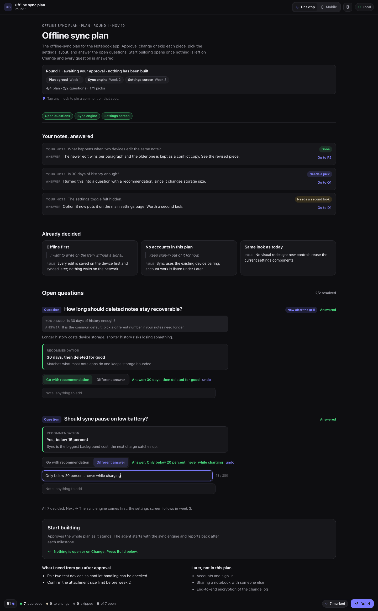
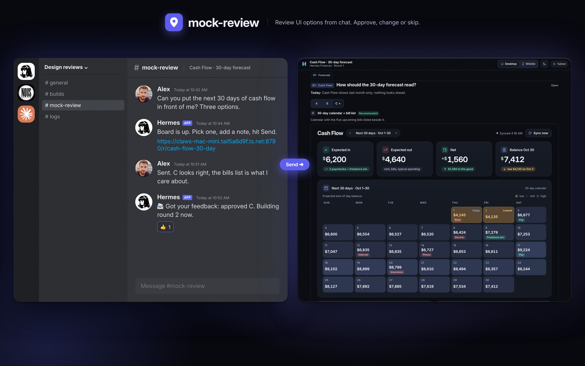

# mock-review

mock-review is a Hermes plugin for reviewing UI and design options. Your agent builds a decision round, the plugin
serves it as a review board, and you open the link, mark each decision Approve, Change or Skip, add notes, drop pins on
the mocks and press Send. Send wakes the agent in the chat the review came from, with your marks attached. Boards render
inline mocks at desktop, tablet and phone widths, in light and dark, and wear a per-project design profile.

## Plan boards and Build

A `plan` preset round uses the same fixed skeleton as a design board: a status line, "Already decided", a defaults card,
the plan grouped by section, then a final approval. Questions carry a recommendation (go with it, or type a different
answer); pieces, defaults and decisions are approved, changed or skipped, and "Approve the rest" fills a section in one
press. The footer has one button. By default it is "Build": locked, with what is still open in its
tooltip, until every question is answered, everything else is approved or skipped and nothing is on Change; a block on
Change turns it into "Send" for those notes. Set `footer_button` to `send` for a board that only ever sends notes.
Mocks carry working controls by default (`interactive_elements`): the board opens on Tap so dropdowns and switches
respond, and Pin in the header switches to commenting. The section bar stays pinned under the header, so a long plan is
one tap from any section.

Build wakes Hermes on the chat the board came from, with the approved plan. The agent builds, and the result arrives as
the next round on the same link, with "Your notes, answered" and Revised badges on the blocks that changed.

A design profile is bound to a project once, with `hermes mockreview design bind <name> <abs project path>`. It then
auto-applies to every create and add-round in that project (or its git repository and worktrees). A round whose mocks use
off-profile colours or fonts is refused before anything is written, and the message names the exact location and value.
`--off-brand "<reason>"` is the only bypass; the reason is recorded on the round and the review.

To see a plan board without an agent, create the demo from a checkout with a board running (see Quickstart):

    hermes mockreview create --title "Offline sync plan" --platform local --chat-id demo --project "$PWD" --decisions "$PWD/examples/plan-demo/decisions.json" --no-design --no-wake

`examples/plan-demo/decisions.json` uses every 1.2 block; the printed link opens round 1.

## Install

Requires Hermes 0.22.0 or newer and Python 3.9 or newer. The plugin has no Python dependencies.

Once the plugin is in the Hermes catalog:

    hermes plugins install mock-review

Until then, install it from GitHub:

    hermes plugins install apelabs-dev/hermes-mock-review

Enable it if the installer did not: `hermes plugins enable mock-review`.

## Quickstart

    hermes mockreview setup

The wizard checks your Hermes version, works out which chat platform to wake you in, enables the webhook platform if you
agree, creates the signing secret, adds a wake route and a notice route for that platform, picks the hosting mode, turns on
autostart, validates the plugin and creates a test review. Add `--dry-run` to see the plan without changing anything, or
`--yes` to accept the defaults without questions.

Which chat platform: setup reads the platforms in the Hermes config. The webhook ingress, the Microsoft Graph ingress, the
API server and the local CLI are not chats, so they never count. With one chat platform configured, setup uses it and says
so. With several, it asks (Enter means all of them); under `--yes` or `--dry-run` it stops and asks you to choose with
`--origin-platform NAME` (repeatable). With none, it stops the same way. Either stop happens before anything is changed.
An explicit `--origin-platform` is always used as given.

The first run usually ends with the test review marked `pending (board not running)`: the review is saved and loads by
itself once the board runs, and setup prints no link until a board answers. The last lines of the output start with
`next:` and say what to do for your setup. In short:

1. Start the board. Inside the gateway: if it is running, restart it (`hermes gateway restart`, or stop and run again a
   gateway you started with `hermes gateway run`); if it is stopped, start it (`hermes gateway run`, or
   `hermes gateway start` for the installed service). Wake-ups need the gateway either way. To run nothing inside the
   gateway, run `hermes mockreview serve` in a terminal instead.
2. Optional: run `hermes mockreview setup` again. It is safe to repeat: it reuses the secret and routes, notices the
   board that is already running, closes the earlier test review, and creates a new one whose `board url:` you can open.
3. Ask your agent for a design review. It calls `mock_review_create` and posts the link. This is the real test of the
   wake-up: press Send on the board and the agent answers in the chat.

### Let the woken session build (opt-in)

Hermes runs the session Send wakes with its safe webhook tools only, so by default that session replies "Round N
feedback is saved; the build continues in this thread's chat session." and the chat's own session builds the round. To
let the woken session build right away, set the toolsets, re-run setup and add the line it prints by hand. Include `mock-review` so it can call the
mock_review tools; the list replaces Hermes's webhook default rather than adding to it:

    hermes config set plugins.entries.mock-review.settings.wake_toolsets "mock-review,terminal,file"
    hermes mockreview setup

Setup never edits Hermes's route file: it prints the `"toolsets"` line to add to the wake route in
`webhook_subscriptions.json` (Hermes keeps this a manual step so an agent cannot grant itself tools). Each setup run
re-subscribes the route and drops the key, so add it again afterwards. It refuses while a board's Send button would be ungated (a here.now board with its password off, or
the server listening beyond loopback), because feedback typed there would reach those tools. Read [security](docs/security.md#tools-for-the-woken-session-wake_toolsets) first.

### Try a board without an agent

With a board running (step 1), create a review from a terminal. `examples/demo-variants` holds three full-page variants of
one pricing page; this one opens as a live prototype:

    EXAMPLES="${HERMES_HOME:-$HOME/.hermes}/plugins/mock-review/examples/demo-variants"   # from a checkout: "$PWD/examples/demo-variants"
    hermes mockreview create --title "Pricing page" --platform local --chat-id demo --no-wake --allow-live-demo \
      --prototype "$EXAMPLES/a-calm-editorial/index.html"

It prints the review's `url`. `--no-wake` makes it a board nobody is woken by, so no signing secret or route is needed.
A live prototype opens in **Use it** mode, so clicks work the page. To leave a comment, switch the header to **Pin** and
tap the spot; after each pin the board goes back to Use it.
Agents write decision rounds instead; see [docs/decisions-format.md](docs/decisions-format.md).

## Hosting modes

A review is hosted in one of three ways. Set the default with `default_host`, or let the agent ask you.

- `local` (the default): the board is served from this computer. With the default bind address the link opens on this
  computer only. Setting `host` to `0.0.0.0` makes local links open on other devices on your network, with no login.
- `tailnet`: the board stays on loopback and you expose it with `tailscale serve`. The link is your Tailscale address, so
  only your tailnet can open it. `setup` offers this when Tailscale is running, and `setup --hosting tailnet` selects it.
- `herenow`: the board is published on here.now with a password gate by default; feedback comes back through its Site Data. This
  needs the official here-now Hermes skill and a `HERENOW_API_KEY`. Create/add-round/publish return a `password`
  beside the URL: send both to the reviewer. Use `--no-password` on create only for an intentionally public board.
  Change an open board with `hermes mockreview password <id> on|off` or `/mockreview password <id> <on|off>`.
  A prototype round on a password-gated here.now board is bundled into one self-contained HTML file (local CSS, scripts,
  images and fonts inlined; a missing or unsupported reference fails the call), then published and loaded in a real
  Chrome, Chromium or Edge behind its password inside the sandboxed iframe; failed requests or an unstyled page fail the
  publish and the link and password are withheld. The sandboxed frame has an opaque origin, so the `SameSite=Lax` unlock
  cookie is not sent with its requests and any file left on the site would 401; fetching the URLs with `curl` and the cookie
  proves nothing. Set `MOCKREVIEW_BROWSER` if the browser is not found. Details in
  [docs/hosting.md](docs/hosting.md#prototype-rounds-on-a-password-gated-board).

[docs/hosting.md](docs/hosting.md) covers each mode step by step.

## Platforms

macOS and Linux run everything, including the board inside the gateway process (autostart). On Windows, run the board in
the foreground with `hermes mockreview serve`. The plugin installs no service files on any platform.

Known issue: here.now publishing runs the official skill's Bash helper. On Windows it requires Git Bash on `PATH`
with compatible paths, or running Hermes and the plugin inside WSL. Native Windows without Bash cannot publish
here.now reviews; local hosting does not need Bash. See [hosting requirements](docs/hosting.md#herenow).

## Other agents (MCP)

Claude Code, Codex and OpenCode can use the same boards without Hermes in the loop: `mockreview/mcp.py` serves the five
`mock_review_*` tools over stdio, so a coding agent can create a board, add a round and read the reviewer's marks
itself. The canonical command is `<abs>/bin/mockreview mcp` (the checkout or installed plugin directory);
`python -m mockreview.mcp` runs the same server when the package is on the import path. Details:
[docs/mcp.md](docs/mcp.md).

Wake is off for MCP boards by default, because an external CLI has no Hermes session to wake: the agent reads the marks
with `mock_review_feedback`. Add `--wake` plus `--platform` and `--chat-id` (or `origin_platform` and `origin_chat_id`
on one call) only when the session context names a real chat. A receiver of your own can be supplied through
`MOCKREVIEW_WEBHOOK_URL`; see the receiver contract in [docs/mcp.md](docs/mcp.md#wake-without-hermes). A `local` link
opens on the computer running the board; use `herenow` (password protected by default) or `tailnet` to open it on a phone.

Claude Code, project scope (use `--mcp-config` with a JSON file for a one-off):

    claude mcp add --transport stdio --scope project mock-review -- <abs>/bin/mockreview mcp

Codex, in `~/.codex/config.toml`:

    [mcp_servers.mock-review]
    command = "python3"
    args = ["<abs>/bin/mockreview", "mcp"]

OpenCode, in `opencode.json`:

    {
      "mcp": {
        "servers": {
          "mock-review": {
            "type": "local",
            "command": ["<abs>/bin/mockreview", "mcp"],
            "disabled": false
          }
        }
      }
    }

## Commands and reference

`hermes mockreview <command>` and the `/mockreview` slash command (list, open, close, password, settings). The agent uses five
tools: `mock_review_create`, `mock_review_add_round`, `mock_review_feedback`, `mock_review_ack` and `mock_review_list`.

- [docs/cli.md](docs/cli.md): every command with its flags
- [docs/settings.md](docs/settings.md): every setting, its default and its environment variable
- [docs/decisions-format.md](docs/decisions-format.md): the `decisions.json` blocks an agent writes
- [docs/hosting.md](docs/hosting.md), [docs/security.md](docs/security.md) and
  [docs/troubleshooting.md](docs/troubleshooting.md)

## Disclosures

What the plugin does that you may want to know before installing it.

Background server. When `autostart` is on, the plugin starts a board web server on a background thread inside the Hermes
gateway process, plus one worker thread that retries undelivered wake-ups, polls here.now and runs the optional
auto-close and cleanup of old reviews. `autostart` is off until `hermes mockreview setup` turns it on. The CLI,
`hermes plugins validate` and Kanban workers never start a server. `hermes mockreview serve` runs the same server in the
foreground instead.

Bind address and port. The server listens on `127.0.0.1:8790` by default (settings `host` and `port`). If you set `host`
to `0.0.0.0`, every device that can reach your computer on that port can open every review and send feedback. There is no
login. Do this only on a network you trust. Setup prints this warning before it makes the change.

Outbound network calls:

- The Hermes webhook on `http://localhost:8644` (setting `webhook_url`): a signed POST when you press Send, to wake your
  agent. It stays on your computer.
- The same local webhook again, on a second route (`<webhook_route>-<platform>-notice`): up to two more signed POSTs,
  still loopback only. One right after the wake-up is accepted (an instant "got it, working on round N" in the origin
  chat, also mirrored into that chat's session), and one later, only when a sent round gets no new round within
  `stale_after_minutes` (or `stale_after_read_minutes` after the agent read it; both times `build_stale_factor` after
  Build), to say the agent may have stalled. No
  ping for a round with nothing left to build, one the agent acknowledged, or a closed review. Both carry the review title and counts, never your notes, and
  use the same signing secret as the wake-up.
- here.now (`https://here.now/api/v1`), only for reviews you host with `herenow`: the plugin publishes the board and
  reads submitted feedback using your key. It publishes through the official here-now skill's `publish.sh`.
- Nothing else. There is no telemetry, analytics or update check.

Credentials. The plugin reads two secrets through Hermes's secret scope, or from the process environment when it runs
without Hermes (the stdio MCP server), and keeps none of its own:
`MOCKREVIEW_WEBHOOK_SECRET` (signs the wake-up request; setup generates it and stores it with `hermes config set`) and
`HERENOW_API_KEY` (optional, here.now hosting only). Both are declared as optional secrets in `plugin.yaml`.

Shell commands. `bash <here-now skill>/scripts/publish.sh` publishes a here.now review, with `HERENOW_API_KEY` passed in
the child environment. `tailscale status --json` and `tailscale serve status --json` find your tailnet address and existing
routes when you use tailnet hosting (on macOS, the app's own binary when the `tailscale` symlink crashes); they only
read, and setup prints any `tailscale serve` command for you to run. `setup` also
runs `hermes` subcommands: `--version`, `gateway status` and `config get` to read the current state, and `config set`,
`config unset` for obsolete settings, `webhook subscribe`, `webhook remove` (only for a self-delivering route left by an
older setup, and only after you confirm) and `plugins validate` to make its changes.

Files. Reviews are stored under `$HERMES_HOME/workspace/mock-reviews` (setting `data_dir`). The plugin reads the Hermes
`config.yaml` through Hermes, or directly for its own settings when it runs outside the gateway.

## Development

    python -m pytest -q

The suite needs `pytest` and `pyyaml`. [AGENTS.md](AGENTS.md) describes the layout and the rules a change has to keep.
[CHANGELOG.md](CHANGELOG.md) lists releases.

### Releasing

Commits on `main` drive the version, through `.github/workflows/release-please.yml` (Release Please, pinned to a commit).
Every push opens or updates one release pull request; merging it bumps the version, prepends the changelog entry, tags
`vX.Y.Z` and publishes the GitHub release.

- `fix:` and `perf:` commits cut a patch release, `feat:` a minor, `feat!:` or a `BREAKING CHANGE:` footer a major.
- `docs:`, `test:`, `ci:` and `chore:` commits cut no release on their own.
- Do not edit the version by hand. `release-please-config.json` names the files that carry it: `plugin.yaml` and
  `mockreview/__init__.py`, each marked `x-release-please-version`, plus `.release-please-manifest.json`. A test fails
  when they disagree.
- After a release the catalog pin stays manual: a pull request against `NousResearch/hermes-agent` that points its
  catalog at the new tag.
- The action needs one repository setting, once: Settings > Actions > General > Workflow permissions, "Allow GitHub
  Actions to create and approve pull requests".

## License

MIT. See [LICENSE](LICENSE).

Safe absolute HTTP(S) links in mock/option HTML open in a new tab with `noopener noreferrer`. Table cells remain
text, with bare absolute HTTP(S) URLs linked even inside prose or alongside other URLs. Surrounding punctuation
and literal HTML stay text. Relative URLs and other link protocols are not linked.
See [password hosting and recovery](docs/hosting.md#herenow) and [security](docs/security.md).
