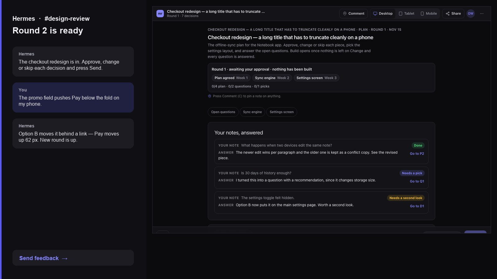
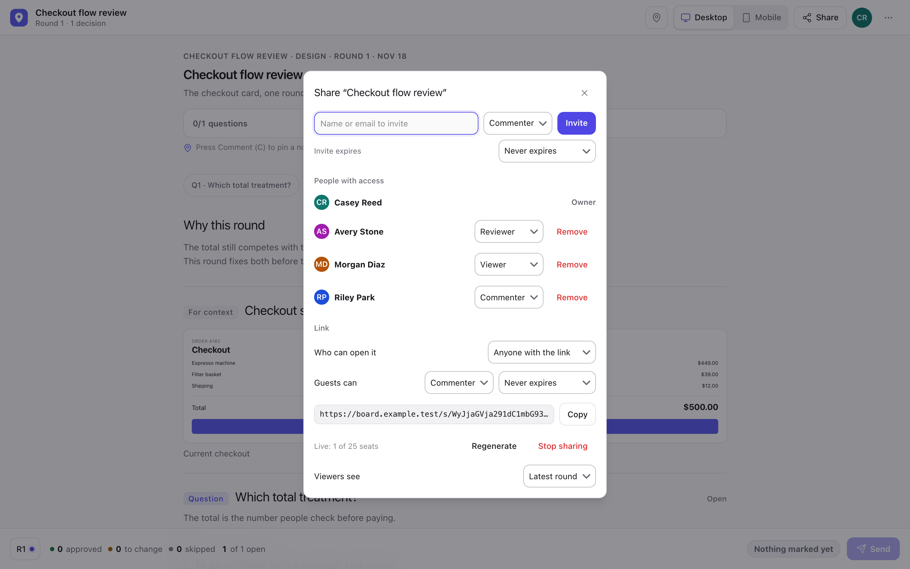
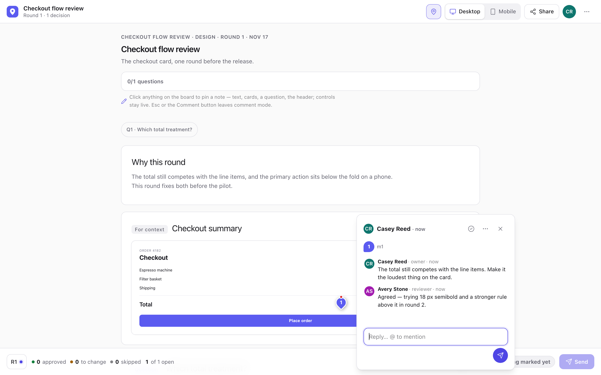
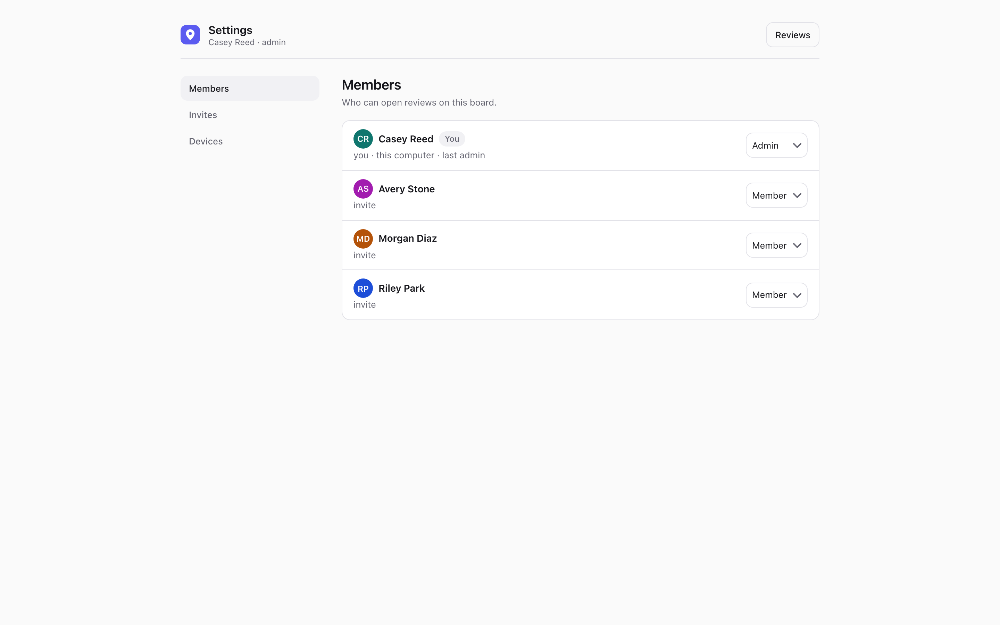

# mock-review

mock-review is a Hermes plugin for reviewing UI and design options. Your agent builds a decision round, the plugin
serves it as a review board, and you open the link, mark each decision Approve, Change or Skip, add notes, drop pins on
the mocks and press Send. Send wakes the agent in the chat the review came from, with your marks attached. Boards render
inline mocks at desktop, tablet and phone widths, in light and dark, and wear a per-project design profile.

With viewer access you can also export a round as PNG, PDF, HTML or Markdown, with or without its comments.

## Plan boards and Build

A `plan` preset round uses the same fixed skeleton as a design board: a status line, "Already decided", a defaults card,
the plan grouped by section, then a final approval. Questions carry a recommendation (go with it, or type a different
answer); pieces, defaults and decisions are approved, changed or skipped, and "Approve the rest" fills a section in one
press. The footer has one button. By default it is "Build": locked, with what is still open in its
tooltip, until every question is answered, everything else is approved or skipped and nothing is on Change; a block on
Change turns it into "Send" for those notes. Set `footer_button` to `send` for a board that only ever sends notes.
Mocks carry working controls by default (`interactive_elements`): the board opens usable, so dropdowns and switches
respond, and Comment (or `C`) switches to pinning a note. The section bar stays pinned under the header, so a long plan is
one tap from any section.

Build wakes Hermes on the chat the board came from, with the approved plan. The agent builds, and the result arrives as
the next round on the same link, with "Your notes, answered" and Revised badges on the blocks that changed.

A design profile is bound to a project once, with `hermes mockreview design bind <name> <abs project path>`. It then
auto-applies to every create and add-round in that project (or its git repository and worktrees). A round whose mocks use
off-profile colours or fonts is refused before anything is written, and the message names the exact location and value.
`--off-brand "<reason>"` is the only bypass; the reason is recorded on the round and the review.

To see a plan board without an agent, create the demo from a checkout with a board running (see Quickstart):

    hermes mockreview create --title "Offline sync plan" --platform local --chat-id demo --project "$PWD" --decisions "$PWD/examples/plan-demo/decisions.json" --no-design --no-wake

`examples/plan-demo/decisions.json` uses every 1.2 block; the printed link opens round 1.

## Install

Requires Hermes 0.22.0 or newer and Python 3.11-3.14. Hermes installs the plugin's one Python dependency, `itsdangerous`, from `pyproject.toml`. PyJWT is an optional `crypto` extra, needed only for Cloudflare Access sign-in.

Once the plugin is in the Hermes catalog:

    hermes plugins install mock-review

Until then, install it from GitHub:

    hermes plugins install apelabs-dev/hermes-mock-review

Enable it if the installer did not: `hermes plugins enable mock-review`.

## Quickstart

    hermes mockreview setup

The wizard checks your Hermes version, works out which chats to wake you in, enables the webhook platform if you agree,
creates the signing secret, adds a wake route and a notice route for each messaging platform, asks to let Hermes Desktop
chats be woken, picks the hosting mode, turns on autostart, validates the plugin and creates a test review. Add
`--dry-run` to see the plan without changing anything, or `--yes` to accept the defaults without questions.

Which chats: setup reads the platforms in the Hermes config and sets up every messaging platform it finds, plus Hermes
Desktop chats. The webhook ingress, the Microsoft Graph ingress, the API server and the agent-protocol adapters are not
chats, so they never count. With several messaging platforms it asks on a terminal (Enter means all of them); under
`--yes` or `--dry-run` it takes them all and says so. With none, it sets up Desktop chats only. `--origin-platform NAME`
(repeatable; `local` is Desktop) narrows it to exactly what you name. A Desktop chat is woken inside its own session,
which needs Hermes's `allow_gateway_injection` consent: setup asks for it and needs an explicit yes (`--yes` only
prints the command). See [which chats can be woken](docs/hosting.md#which-chats-can-be-woken).

The first run usually ends with the test review marked `pending (board not running)`: the review is saved and loads by
itself once the board runs, and setup prints no link until a board answers. The last lines of the output start with
`next:` and say what to do for your setup. In short:

1. Start the board. Inside the gateway: if it is running, restart it (`hermes gateway restart`, or stop and run again a
   gateway you started with `hermes gateway run`); if it is stopped, start it (`hermes gateway run`, or
   `hermes gateway start` for the installed service). Wake-ups need the gateway either way. To run nothing inside the
   gateway, run `hermes mockreview serve` in a terminal instead.
2. Optional: run `hermes mockreview setup` again. It is safe to repeat: it reuses the secret and routes, notices the
   board that is already running, closes the earlier test review, and creates a new one whose `board url:` you can open.
3. Ask your agent for a design review. It calls `mock_review_create` and posts the link. This is the real test of the
   wake-up: press Send on the board and the agent answers in the chat.

### Let the woken session build (opt-in)

Hermes runs the session Send wakes with its safe webhook tools only, so by default that session replies "Round N
feedback is saved; the build continues in this thread's chat session." and the chat's own session builds the round. To
let the woken session build right away, set the toolsets, re-run setup and add the line it prints by hand. Include `mock-review` so it can call the
mock_review tools; the list replaces Hermes's webhook default rather than adding to it:

    hermes config set plugins.entries.mock-review.settings.wake_toolsets "mock-review,terminal,file"
    hermes mockreview setup

Setup never edits Hermes's route file: it prints the `"toolsets"` line to add to the wake route in
`webhook_subscriptions.json` (Hermes keeps this a manual step so an agent cannot grant itself tools). Each setup run
re-subscribes the route and drops the key, so add it again afterwards. It refuses while the server listens beyond
loopback, because feedback typed there would reach those tools. Read [security](docs/security.md#tools-for-the-woken-session-wake_toolsets) first.

### Try a board without an agent

With a board running (step 1), create a review from a terminal. `examples/demo-variants` holds three full-page variants of
one pricing page; this one opens as a live prototype:

    EXAMPLES="${HERMES_HOME:-$HOME/.hermes}/plugins/mock-review/examples/demo-variants"   # from a checkout: "$PWD/examples/demo-variants"
    hermes mockreview create --title "Pricing page" --platform local --chat-id demo --no-wake --allow-live-demo \
      --prototype "$EXAMPLES/a-calm-editorial/index.html"

It prints the review's `url`. `--no-wake` makes it a board nobody is woken by, so no signing secret or route is needed.
A live prototype opens in **Use it** mode, so clicks work the page. To leave a comment, switch the header to **Pin** and
tap the spot; after each pin the board goes back to Use it.
Agents write decision rounds instead; see [docs/decisions-format.md](docs/decisions-format.md).

## Sharing

A review is hosted in one of three ways. Set the default with `default_host`, or let the agent ask you.

- `local` (the default): the board is served from this computer. With the default bind address the link opens on this
  computer only. Setting `host` to `0.0.0.0` makes local links reachable from other devices on your network; people
  there get the sign-in page and join with an invite or a share link.
- `tailnet`: the board stays on loopback and you expose it with `tailscale serve`. The link is your Tailscale address,
  so only your tailnet can open it. `setup` offers this when Tailscale is running, and `setup --hosting tailnet`
  selects it.
- `public`: a public URL behind Tailscale Funnel or any TLS proxy. `hermes mockreview public on` maps one Funnel port
  and prints the URL; any other proxy works with `public_url` and `trusted_proxies`. Reviewers sign in with an invite
  or a share link. See [docs/public-hosting.md](docs/public-hosting.md).

[docs/hosting.md](docs/hosting.md) covers each mode step by step.

Sharing a review with other people is separate from hosting it. An **invite** (`hermes mockreview invite`) creates an
account and works once; a **share link** gives access to one review without an account, and the link itself is the
guest's credential. A review has at most one share link, managed by its owner in the Share dialog or with
`hermes mockreview share <review id>`. The link carries its own guest role — `reviewer`, `commenter` (the default) or
`viewer` — and can be limited to signed-in members, given an expiry, and pinned to one round for viewer guests.

A guest opens the link with its role and gets a server-assigned name such as "Calm Otter"; the name is unique among
that review's live guests and can be changed. A viewer sees only the round the link names, with no feedback pins,
notes or submit token. A commenter can comment on any round; a reviewer can also send feedback and ask for a pin fix,
but a guest never wakes Hermes: Send is stored for the owner. Regenerating or stopping the link ends every guest
session of the old link.

Pins are conversations now: each pin opens a thread with replies, resolve/reopen, optional `@Hermes` mentions, and live
updates on every open board. An owner's or reviewer's `@Hermes` comment wakes Hermes once per comment; the board answers
at once and the worker tick delivers it, coalescing a burst into one wake, and the anchored block carries a working
chip until the session replies. It replies in the thread and patches the block in place when the comment asks for it; a
guest, an agent token and a wake-off board never wake anyone. The wake goes to the chat the review was created
from; [docs/comments.md](docs/comments.md) says what the session does there. Comments and their history live in the review's own
database under the data root. See [docs/comments.md](docs/comments.md) and [docs/security.md](docs/security.md).

The board opens in the `inline` layout by default: a flowing document with thin rules and no card backgrounds. Set
`layout` to `cards` for the bordered, rounded sections of 2.0.0. The choice is stored in each review when it is
created, so changing the setting leaves open reviews as they are.

## People and access

There are no passwords. The board server has accounts, and every request is checked against who is asking.

- The owner is this computer: a request from the board's own machine is the install's admin. Turn `loopback_owner`
  off and the owner signs in with a one-time link instead, `hermes mockreview login`.
- People join with a single-use invite link (`hermes mockreview invite`, 7 days by default, `--expires` to change it).
  An invite creates an account; a share link does not.
- Accounts live in one flat user directory per install. Each account is a member or an admin; admins manage every
  review and see Members and Invites in Settings. The last admin cannot be demoted or the only admin deleted.
- Access is granted per review: `viewer` (look), `commenter` (look and comment) or `reviewer` (look, comment and send
  feedback), optionally with an expiry. A grant for all reviews is a convenience flag, not a workspace or a team.
  `hermes mockreview users grant <name|id> --review <review id> --role reviewer --expires 30d` is the CLI form.
- Personal access tokens (`hermes mockreview tokens create --user <id> <name>`) let a coding agent comment as that
  account; the token is shown once and stored hashed.

A device stays signed in: a session lasts 30 days from its last use, so a phone or laptop signs in once with a link
and is not asked again while it is in use. Settings > Devices lists your signed-in devices and can sign the others out.
On a tailnet or public board, setup ends by printing a first sign-in link, and until you have used one, the agent's
create and add-round results carry a fresh link for it to hand over. A link works once and expires after 15 minutes.

Roles and grants are read again on every request, so a change applies immediately. The full model — sessions, proxy
identities, share-link seats, throttling and audit — is in [docs/security.md](docs/security.md); the migration from
the old password/hosting model is in [docs/migrating-to-2.md](docs/migrating-to-2.md).

## Platforms

macOS and Linux run everything, including the board inside the gateway process (autostart). On Windows, run the board in
the foreground with `hermes mockreview serve`. The plugin installs no service files on any platform.

## Other agents (MCP)

Claude Code, Codex and OpenCode can use the same boards without Hermes in the loop: `mockreview/mcp.py` serves the six
`mock_review_*` tools over stdio, so a coding agent can create a board, add a round and read the reviewer's marks
itself. With a personal access token (`mockreview tokens create --user <id> <name>`, passed as `--token` or
`MOCKREVIEW_TOKEN`) it also gets three comment tools — `list_comments`, `reply` and `resolve` — so it can work through
the board's threads as the person whose token it holds; an `@Hermes` mention there never wakes Hermes. The canonical
command is `<abs>/bin/mockreview mcp` (the checkout or installed plugin directory);
`python -m mockreview.mcp` runs the same server when the package is on the import path. Details:
[docs/mcp.md](docs/mcp.md).

Wake is off for MCP boards by default, because an external CLI has no Hermes session to wake: the agent reads the marks
with `mock_review_feedback`. Add `--wake` plus `--platform` and `--chat-id` (or `origin_platform` and `origin_chat_id`
on one call) only when the session context names a real chat. A receiver of your own can be supplied through
`MOCKREVIEW_WEBHOOK_URL`; see the receiver contract in [docs/mcp.md](docs/mcp.md#wake-without-hermes). A `local` link
opens on the computer running the board; use `tailnet` to open it on a phone.

Claude Code, project scope (use `--mcp-config` with a JSON file for a one-off):

    claude mcp add --transport stdio --scope project mock-review -- <abs>/bin/mockreview mcp

Codex, in `~/.codex/config.toml`:

    [mcp_servers.mock-review]
    command = "python3"
    args = ["<abs>/bin/mockreview", "mcp"]

OpenCode, in `opencode.json`:

    {
      "mcp": {
        "servers": {
          "mock-review": {
            "type": "local",
            "command": ["<abs>/bin/mockreview", "mcp"],
            "disabled": false
          }
        }
      }
    }

## Commands and reference

`hermes mockreview <command>` and the `/mockreview` slash command (list, open, close, settings). The agent uses nine
tools. Six work on boards: `mock_review_create`, `mock_review_add_round`, `mock_review_feedback`, `mock_review_ack`,
`mock_review_list` and `mock_review_patch_block`. Three work on comment threads: `mock_review_list_comments`,
`mock_review_reply` and `mock_review_resolve`.

- [docs/cli.md](docs/cli.md): every command with its flags
- [docs/settings.md](docs/settings.md): every setting, its default and its environment variable
- [docs/design.md](docs/design.md): the 2.0 design system, tokens and the rules the tests hold
- [docs/decisions-format.md](docs/decisions-format.md): the `decisions.json` blocks an agent writes
- [docs/desktop.md](docs/desktop.md): the Mocks tab in Hermes Desktop (list, read-only viewer, delete)
- [docs/hosting.md](docs/hosting.md), [docs/security.md](docs/security.md) and
  [docs/troubleshooting.md](docs/troubleshooting.md)

## Disclosures

What the plugin does that you may want to know before installing it.

Background server. When `autostart` is on, the plugin starts a board web server on a background thread inside the Hermes
gateway process, plus one worker thread that retries undelivered wake-ups and runs the optional auto-close and cleanup of
old reviews. `autostart` is off until `hermes mockreview setup` turns it on. The CLI, `hermes plugins validate` and
Kanban workers never start a server. `hermes mockreview serve` runs the same server in the foreground instead.

Bind address and port. The server listens on `127.0.0.1:8790` by default (settings `host` and `port`). If you set `host`
to `0.0.0.0`, every device that can reach your computer on that port gets the sign-in page: people join with an invite
(`hermes mockreview invite`) or the review's share link. Do this only on a network you trust. Setup prints this warning before it makes the change.

Outbound network calls:

- The Hermes webhook on `http://localhost:8644` (setting `webhook_url`): a signed POST when you press Send, to wake your
  agent. It stays on your computer.
- The same local webhook again, on a second route (`<webhook_route>-<platform>-notice`): up to two more signed POSTs,
  still loopback only. One right after the wake-up is accepted (an instant "got it, working on round N" in the origin
  chat, also mirrored into that chat's session), and one later, only when a sent round gets no new round within
  `stale_after_minutes` (or `stale_after_read_minutes` after the agent read it; both times `build_stale_factor` after
  Build), to say the agent may have stalled. No
  ping for a round with nothing left to build, one the agent acknowledged, or a closed review. Both carry the review title and counts, never your notes, and
  use the same signing secret as the wake-up.
- Cloudflare Access only: when `cloudflare_team` and `cloudflare_audience` are both set, a GET to
  `https://<team>.cloudflareaccess.com/cdn-cgi/access/certs` fetches the team's public signing keys, so the board can
  check the `Cf-Access-Jwt-Assertion` token on a request. The keys are cached for an hour. Nothing is sent but the request itself.
- Nothing else. There is no telemetry, analytics or update check.

Credentials. The plugin reads one secret through Hermes's secret scope, or from the process environment when it runs
without Hermes (the stdio MCP server), and keeps none of its own: `MOCKREVIEW_WEBHOOK_SECRET` (signs the wake-up
request; setup generates it and stores it with `hermes config set`). It is declared as an optional secret in
`plugin.yaml`.

Shell commands. `tailscale status --json` and `tailscale serve status --json` find your tailnet address and existing
routes when you use tailnet hosting (on macOS, the app's own binary when the `tailscale` symlink crashes); they only
read, and setup prints any `tailscale serve` command for you to run. `tailscale funnel status --json` also only reads:
it finds the Funnel URL of this board for a public review. `hermes mockreview public on` runs
`tailscale funnel --bg --yes --https=<port> http://127.0.0.1:<port>` to map one Funnel port to the loopback board, and
`public off` runs `tailscale funnel --https=<port> off` to remove it. Both run only when you ask, and neither touches a
port that serves something other than this board. To match a saved design profile to a project, it
runs `git -C <project> rev-parse --show-toplevel --git-common-dir`, which only reads the project's git toplevel and,
inside a linked worktree, the main checkout. `setup` also
runs `hermes` subcommands: `--version`, `gateway status` and `config get` to read the current state, and `config set`,
`config unset` for obsolete settings, `webhook subscribe`, `webhook remove` (only for a self-delivering route left by an
older setup, and only after you confirm) and `plugins validate` to make its changes.

Files. Reviews are stored under `$HERMES_HOME/workspace/mock-reviews` (setting `data_dir`). The plugin reads the Hermes
`config.yaml` through Hermes, or directly for its own settings when it runs outside the gateway.

## Development

    uv run --with-requirements requirements-dev.txt python scripts/check.py fast
    uv run --with-requirements requirements-dev.txt python scripts/check.py changed --base main
    uv run --with-requirements requirements-dev.txt python scripts/check.py full

`fast` runs every non-browser test in parallel (fail-fast, under a minute on a quiet machine). `changed` maps the
branch's changed files to the tests they can affect, plus a small always-on smoke set; an unmapped path falls back to
the non-browser tier, and `full` is the acceptance run. `full` runs the non-browser tier first and then the browser
modules in a pool, each in its own pytest process, so a module's Chrome is reused and the suite fits in bounded
foreground parts (`--part nonbrowser` or `--part browser` runs one half). A failed non-browser phase stops the run
before any browser starts; `--all` runs both phases and shows every failure, so it is the form to use when one run
must catch a broken non-browser and a broken browser assertion (the mutation demonstration uses `full --all`).

The browser modules are discovered, not just listed: the runner takes every module that actually carries
`pytest.mark.browser` and unions it with its schedule. A new browser module needs the mark; leaving its name out of
the schedule still runs it (with a warning and one worker), while a listed module that lost the mark fails the run.
A lower `CHECK_CHROMES` budget only changes how many workers a browser module gets, never which modules run; work
that cannot be scheduled is reported as a failure, never dropped. A browser job runs only its marked tests, and a
module that also holds unmarked ones keeps those in the non-browser pass, so every test runs exactly once in both
`full` and `changed`.

A browser module that fails runs once more: only its failed tests after `--all`, the whole module after a fail-fast
run. When the retry passes, the run stays green and each test that failed first is listed as flaky, before the summary
and in its count (and as a warning and a job-summary line on GitHub Actions); a test that fails twice fails the run.
`CHECK_RETRIES=0` turns the retry off. The non-browser tier is never retried.

In CI the four `tests (...)` checks are required. The Linux ones run both tiers. On macOS and Windows the browser tier
runs as a separate `browser tier (...)` check that does not block a pull request: when it fails there, the check stays
green and shows a warning. On main it fails like any other check, and a nightly run of the full matrix opens or
updates a `nightly-ci` issue when anything fails. A pull request that only touches the root Markdown files or `docs/`
skips the browser tier; the non-browser tier, which holds the docs checks, still runs.

The browser harness caps Chromes machine-wide for this OS user: `MOCKREVIEW_CHROMES` (default 3, never more than 4) is
one run's budget, and slot files in `/tmp/mockreview-chrome-slots-<uid>` (POSIX; `%LOCALAPPDATA%\mockreview\chrome-slots`
on Windows) make every process of this user respect the same ceiling, whatever its `TMPDIR` or `HOME` says. It does not
cover other OS users, other machines, or a sandbox that maps `/tmp` away per process; `MOCKREVIEW_CHROME_SLOTS` points
the registry at an explicit directory. Browser tests skip when no Chrome, Chromium or Edge is installed;
`MOCKREVIEW_BROWSER` points at an explicit executable.

`requirements-dev.txt` is development-only. The plugin runtime keeps its one dependency (`itsdangerous`, in
`pyproject.toml` and installed by Hermes), and `pytest`, `pyyaml` and `pytest-xdist` are never part of it.
[AGENTS.md](AGENTS.md) describes the layout and the rules a change has to keep. [CHANGELOG.md](CHANGELOG.md) lists
releases.

### Releasing

Commits on `main` drive the version, through `.github/workflows/release-please.yml` (Release Please, pinned to a commit).
Every push opens or updates one release pull request; merging it bumps the version, prepends the changelog entry, tags
`vX.Y.Z` and publishes the GitHub release.

- `fix:` and `perf:` commits cut a patch release, `feat:` a minor, `feat!:` or a `BREAKING CHANGE:` footer a major.
- `docs:`, `test:`, `ci:` and `chore:` commits cut no release on their own.
- Do not edit the version by hand. `release-please-config.json` names the files that carry it: `plugin.yaml` and
  `mockreview/__init__.py`, each marked `x-release-please-version`, plus `.release-please-manifest.json`. A test fails
  when they disagree.
- After a release the catalog pin stays manual: a pull request against `NousResearch/hermes-agent` that points its
  catalog at the new tag.
- The action needs one repository setting, once: Settings > Actions > General > Workflow permissions, "Allow GitHub
  Actions to create and approve pull requests".

## License

MIT. See [LICENSE](LICENSE).

Safe absolute HTTP(S) links in mock/option HTML open in a new tab with `noopener noreferrer`. Table cells remain
text, with bare absolute HTTP(S) URLs linked even inside prose or alongside other URLs. Surrounding punctuation
and literal HTML stay text. Relative URLs and other link protocols are not linked.
See [hosting](docs/hosting.md) and [security](docs/security.md).
